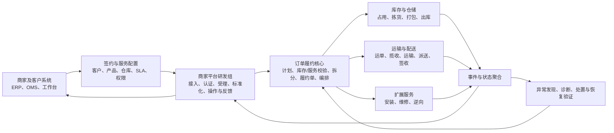

# 入职汇报知识与内容提炼

- 更新时间：2026-08-31
- 状态：持续完善中的内容母稿，不是最终汇报
- 适用岗位：订单履约研发部—商家平台研发组
- 汇报主题方向：AI 如何主动发现、分析并推动解决商家订单履约中的经营与运营问题

## 使用说明

本文把当前已经形成的业务理解、尚未确认的内部假设，以及最终汇报需要提炼的内容集中在一个位置。后续学习、场景选择、PPT、讲稿和答辩均以本文为内容母稿，避免知识与汇报故事线分散。

本文使用三类事实标记：

- **公开事实**：有京东物流官方或权威外部资料支持。
- **行业模型**：物流与订单履约领域的通用理解，可用于建立分析框架。
- **待内部确认**：无法由部门名称或公开资料证明的京东内部组织、系统、数据和流程。

## 一、目前最核心的业务理解

### 1. 京东物流出售的不是单一“快递能力”

**公开事实**：京东物流定位为供应链解决方案与物流服务提供商，能力可覆盖供应链规划、计划、仓储与库存、运输配送等环节。

**行业模型**：客户可根据需求购买不同组合：

1. **纯运输配送**：货在客户自己的仓库，客户完成库存管理、拣货和打包，京东物流负责揽收、运输与配送。
2. **仓配一体**：客户提前将货物放入京东物流管理的仓库，京东物流负责库存、拣货、打包、出库及配送。
3. **一体化供应链**：在仓配基础上进一步包含计划、补货协同、仓间调拨、B2B/B2C履约、逆向等服务。

“供应链采购或补货服务”不等于京东物流必然成为货物买方；货权、采购决策和资金责任取决于具体合同。

### 2. “商家”更接近物流客户，而不只是京东商城店铺

商家可能包括：

- 京东零售自营业务；
- 京东商城第三方商家；
- 在淘宝、抖音、品牌官网等渠道经营的外部企业；
- 需要B2B门店补货或其他物流服务的企业客户。

在京东商城开店不等于必须使用京东物流；使用京东物流也不要求必须在京东商城开店。

### 3. 商家平台的核心位置

**行业模型**：商家平台位于客户系统与京东物流内部履约执行体系之间，其核心价值可以概括为：

> 把客户已经签约的物流服务与每一张实际订单连接起来，将商家意图转化成内部可执行的履约请求，并把跨仓储、运输、配送、安装等系统的结果转换成商家能够理解和操作的履约视图。

商家可以通过工作台人工操作，也可以通过API、消息等方式由ERP/OMS批量接入。大型客户通常不会依靠人工逐单录入。

## 二、大部门端到端业务主线



### 当前对责任边界的假设

**商家平台研发组可能负责**：

- 商家工作台、开放API和消息接入；
- 身份、权限、服务开通结果的校验；
- 订单受理、字段校验、幂等、防重复和标准化；
- 商家订单号与履约单、包裹、运单、服务单的关联视图；
- 状态、轨迹和异常的商家化表达；
- 查询、取消、改址、拦截、补发、工单等操作入口；
- 回调、通知、运营支撑和商家自助处理。

**可能由履约核心或其他组负责**：

- 库存分配、选仓、拆合单和承诺时间计算；
- 履约单的创建及状态机；
- 跨执行系统的履约编排；
- 履约状态聚合和异常判定。

**通常由下游专业域负责**：

- 真实库存账和仓内作业；
- 包裹实际打包结果；
- 运单及运输网络执行；
- 配送、安装、逆向、计费和结算执行。

以上组织归属全部为**待内部确认**。最重要的确认不是系统叫什么，而是每个对象的事实源、写权限和最终结果责任归谁。

## 三、订单与核心业务对象

| 对象 | 回答的问题 | 典型信息 | 消费者是否通常可见 |
|---|---|---|---|
| 交易/商家订单 | 买了什么、客户提出什么需求 | 商品、数量、金额、收件人、来源渠道 | 是 |
| 履约单 | 谁以什么方案完成哪些交付承诺 | 货主、履约主体、仓库、商品、服务产品、承诺时间、履约状态 | 通常否 |
| 出库任务/出库单 | 仓库需要完成什么作业 | SKU、数量、库位、波次、拣货与出库状态 | 否 |
| 包裹 | 现场实际包装和交接什么 | 包裹内容、重量、体积、包装结果 | 部分可见 |
| 运单 | 一个包裹怎样进入运输网络 | 寄收地址、承运产品、路线、轨迹、签收结果 | 通常可见 |
| 安装/服务单 | 配送之外还要完成什么服务 | 服务项目、预约时间、服务人员、完成凭证 | 部分可见 |

基本关系不是固定一对一：

```text
一个商家订单
  → 一个或多个履约单
  → 一个或多个出库任务/包裹
  → 一个或多个运单、安装单或逆向单
```

订单拆成多个履约单的常见依据包括：货主、履约主体、发货仓、库存可用时间、履约模式、物流产品、温层、监管要求和承诺时间。只是物理上装不进一个箱子时，可能只拆包裹而不拆履约单。具体粒度依赖内部领域模型。

## 四、为什么它不只是CRUD

如果商家平台仅做页面、关系保存和状态展示，它确实主要是集成型CRUD。真正的复杂度取决于它是否承担跨系统履约正确性和异常闭环。

### 关键难点

1. **现实与系统状态可能不同**：已出库可能只是系统记录，不能单独证明实物完成交接。
2. **分布式结果不确定**：调用下游超时可能是未执行，也可能是执行成功但响应丢失。
3. **重复、乱序和延迟**：重试可能重复发货，旧事件可能覆盖新状态。
4. **长流程与并发变化**：取消订单可能与仓库出库、运输揽收同时发生。
5. **一对多对象关系**：拆仓、拆包、换单、补发、退货会持续改变单据关系。
6. **状态不等于完成承诺**：运单签收后仍可能有安装未完成；一个包裹签收不代表整个履约完成。
7. **规模放大异常**：极低的异常比例在大单量下仍会产生大量人工处理。
8. **业务语义差异**：不同客户对“已发货”“取消”“商品编码”的定义可能不同。

### 代表性异常案例

```text
商家提交取消
→ 仓库正在处理取消
→ 同时商品完成出库
→ 运输系统已经揽收
→ 原取消失败，需要转物流拦截
→ 拦截结果仍需等待真实执行
```

这个过程中不能直接把履约状态改成“已取消”。系统需要区分“请求已受理”“现场正在处理”和“真实动作已成功”。

## 五、AI场景的业务闭环

老板提出的方向应理解为业务闭环，而不是从多Agent、MCP或Skills等技术名词出发：


可信Agent需要四类基础：

- **实时事实**：订单、履约单、库存、出库、包裹、运单、轨迹、日志和指标；
- **业务知识**：状态机、SLA、服务配置、SOP、责任边界和历史案例；
- **安全工具**：查询、对账、重试、补偿、拦截、工单和通知；
- **控制机制**：权限、审批、审计、风险分级、失败降级和人工接管。

### 当前候选场景

#### 候选一：订单受理异常助手

- 场景：订单下发失败、重复订单、SKU或地址校验失败、服务未开通、下游创建超时。
- 用户：商家运营、接入支持、研发值班。
- 价值：让客户快速知道订单为什么没有进入履约，并减少跨系统人工排查。

#### 候选二：履约停滞诊断助手

- 场景：长时间未分配库存、未出库、已出库未揽收、轨迹停滞、跨系统状态不一致。
- 用户：履约运营、商家客服、研发值班。
- 价值：在违约前发现风险，聚合证据并定位阻塞环节。
- 当前倾向：最容易展示“发现—分析—行动—验证”的完整闭环，但尚未最终选择。

#### 候选三：取消、拦截与补发助手

- 场景：出库后取消、拦截结果未知、破损补发、正逆向状态不一致。
- 用户：商家运营、客服、异常处理人员。
- 价值：把复杂时序、状态和处理SOP转化成可解释、可执行的操作指导。

## 六、最终汇报需要提炼出的内容

当前推荐采用九页左右的故事线，最终页数应根据汇报时长调整。

### 第1页：任务理解

结论：目标不是让AI继续写普通CRUD，而是帮助业务主动发现、分析并推动解决经营与运营问题。

### 第2页：京东物流与商家订单履约全景

讲清：京东物流服务模式、客户类型，以及商家需求如何连接仓储、运输、配送和逆向。

### 第3页：商家平台研发组的位置与边界

讲清：商家平台是企业客户门户、开放接口和履约服务入口的组合；当前内部边界是待验证假设。

### 第4页：为什么履约异常不是简单CRUD

使用一个取消与出库并发，或者创建履约单超时的案例，展示现实状态、多个系统和责任边界的复杂性。

### 第5页：当前人工处理的潜在问题

待内部验证：需要跨多个系统查询、依赖个人经验、证据分散、发现较晚、处置后缺少验证。

### 第6页：AI业务闭环

展示：发现、影响分析、假设、证据、判断、行动、验证和反馈，而不是通用问答机器人。

### 第7页：技术与安全边界

说明规则、监控、传统算法、大模型、Agent和人的分工，以及只读诊断、审批执行、自动执行的风险分级。

### 第8页：价值与评估

候选指标：异常发现提前量、诊断准确率、平均定位时间、平均恢复时间、人工系统跳转次数、自动/辅助闭环率、履约超时减少量和误操作率。

### 第9页：入职后验证与MVP路径

先确认系统边界和Top异常，选择一个高频、证据可得、动作低风险的场景；从只读诊断开始，再逐步开放建议、审批执行和低风险自动化。

## 七、当前可以汇报到什么程度

### 已经可以较清楚讲述

- 京东物流的服务组合与客户类型；
- 商家平台在客户和履约执行体系之间的位置；
- 订单、履约单、包裹、运单和服务单的概念差异；
- 订单拆分和单据非一一对应的原因；
- 商家平台为什么可能存在跨系统一致性与异常闭环难题；
- AI异常助手应遵循的基本业务闭环。

### 仍需继续学习或验证

- 库存口径、选仓、仓内生产和逆向流程；
- SLA、指标口径、计费与经营影响；
- 一个完整异常案例的证据树和处置路径；
- 规则、预测、优化、Agent和人的能力边界；
- 内部Top异常、数据工具、权限和真实业务基线。

### 当前合适的汇报定位

不是宣称已经设计好京东内部AI方案，而是：

> 汇报入职前对任务的理解、订单履约业务模型、AI候选方向、风险边界，以及入职后如何结合真实系统和Top异常完成验证。

## 八、入职后优先确认的问题

1. 团队直接用户是外部商家、内部运营，还是两者都有？
2. 团队实际负责哪些应用、服务和数据库？
3. 商家订单进入后的第一个事实源是不是本组系统？
4. 履约单、拆单决策和状态机分别由哪个系统负责？
5. 订单、履约单、包裹、运单每个对象的唯一事实源是什么？
6. 团队对订单只负责接入和展示，还是对最终履约结果负责？
7. 当前最高频、最耗人工和损失最大的异常分别是什么？
8. 运营处理一次异常需要查询哪些系统、调用哪些动作？
9. 哪些动作可以自动执行，哪些需要审批或只能转交？
10. 团队最重视的是接口成功率、履约成功率、SLA、成本还是客户体验？

## 九、下一步学习顺序

不再广泛增加物流名词，按照以下顺序定点补齐：

```text
库存、选仓和仓内生产
→ 取消、拦截和逆向
→ 状态、事件与证据时间线
→ SLA和经营指标
→ 完整异常诊断闭环
→ Agent能力与安全边界
→ 场景比较和最终选择
```

阶段一知识骨架已经形成，但仍需通过十分钟无稿复述验证；阶段二已经通过订单、单据和系统复杂度问题提前启动。
